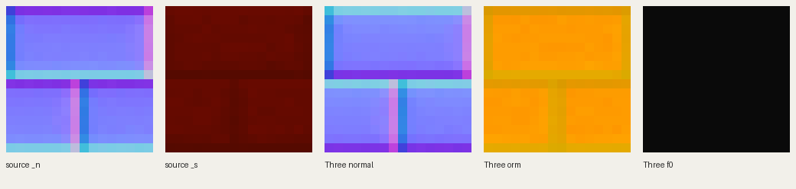

# MC PBR subset for XinEra

This imports authored normal and specular maps from [Poudingue / Vanilla Normals Renewed](https://github.com/Poudingue/Vanilla-Normals-Renewed), pinned to `70d89ee4d401a27c4518ebab3b13897c2a6b6921`. It never manufactures a normal map from albedo, and never replaces the existing scene albedo. The author's redistribution terms are copied unchanged to `public/xinera/pbr/SOURCE-README.md`; the website attribution is `public/xinera/pbr/ATTRIBUTION.md`.

## Rebuild

Extract the pinned source ZIP locally, then run with the project's Node 24 runtime:

```sh
uv run --with pillow python scripts/pbr/build_pack.py --source /path/to/Vanilla-Normals-Renewed-70d89ee4d401a27c4518ebab3b13897c2a6b6921
pnpm exec tsx --test tests/pbr-*.test.ts
```

Pillow does lossless PNG I/O. `labpbr.mjs` is the actual channel converter, used both by the importer and its Node boundary tests. `manifest.json` records the SHA256 of every original selected PNG, the output atlas SHA256, coverage, encoding, and source revision. Atlas filenames include their content hash; the tiny runtime index is compiled into the application, avoiding a separate metadata request.

## Channel contract

| Input | Three output | Detail |
| --- | --- | --- |
| `_n.RG` | RGB tangent normal | Decode to signed XY, flip DirectX Y, reconstruct positive Z; normalize out-of-disk input |
| `_n.B` | ORM red | Ambient occlusion; never used as the tangent normal Z |
| `_s.R` | ORM green | Perceptual roughness `1 - R/255`; Three squares this inside its BRDF |
| `_s.G` below 230 | F0 RGB | Linear scalar `G/255`; stone remains dielectric, even when reflective |
| `_s.G` 230–255 | ORM blue = 255 | Metal; ordinary dielectric pixels receive zero metalness |

All data maps use `NoColorSpace`, `flipY=false` and the same local UV orientation as the exported base-color tiles. The three network PNG atlases are cropped only for actually referenced scene tiles. Each tile owns its mip chain, preventing cross-material mip bleeding; ORM's three consumers share one GPU texture. Normal intensity defaults to the authored value (`normalScale=1`).

The shared material shader consumes linear F0 directly, preserving dielectric reflectance without turning it into metalness or clipping it at Three's default F0=0.04. For a metal, Three's metallic BRDF uses the original block base color; the pack's named-metal complex IOR is not implemented. `_n.A` height/parallax, `_s.B` porosity/subsurface, and `_s.A` emission are not imported. Existing scene light masks and thin-leaf scattering remain authoritative. This is an explicitly bounded normal/roughness/AO/F0/metalness conversion, not the pack's complete Minecraft shader pipeline.

## Verified coverage and added load

Only exact texture-name matches are imported. No renamed block aliases or inferred substitutes are invented.

| Scene metadata | Matched / used unique texture names |
| --- | ---: |
| Homepage cathedral | 94 / 128 |
| Gallery cathedral | 83 / 127 |
| Asa | 162 / 218 |
| Claire | 145 / 192 |
| North | 28 / 38 |
| Royal | 93 / 118 |
| Volcano | 19 / 22 |
| West | 103 / 138 |
| Supplementary cathedral water | 0 / 2 |
| Union of all scenes | **246 / 349** |

Of the 246 matched names, 243 have real normal maps and 244 have real specular maps. The 103 unmatched names retain semantic fallback materials. Source water is unmatched and keeps the dedicated water shader.

- Normal atlas: **83,432 bytes**.
- ORM atlas: **57,414 bytes**.
- F0 atlas: **2,961 bytes**.
- Total additional texture transfer: **143,807 bytes** across **three requests**, shared by every scene and cacheable by content filename.
- Runtime index: **6,065 bytes** before JavaScript compression.
- Detailed provenance manifest: **59,973 bytes**, only downloaded when explicitly opened.
- The complete public folder, including attribution and provenance: **218,269 bytes**. This is not the amount the rendering loader downloads.

## Stone-brick sample



This sample was read from the actual selected source and generated atlas, then inspected visually:

- `_n.R`: 48–203, `_n.G`: 48–204. The source has authored bevels and mortar joints, not a flat normal or an albedo-derived grayscale approximation.
- `_n.B` AO: 217–254. Converted normal Z is independently reconstructed as 218–255.
- `_s.R` smoothness: 85–105. Resulting roughness bytes: 150–170, including spatial variation across the brick.
- `_s.G` is 10. Output dielectric F0 is exactly 10/255; metalness is zero throughout the tile.

Validation covers normal orientation and normalization, smoothness endpoints and midpoint, F0/metal boundary 229/230, exact output checksums, missing texture fallback, shared ORM and request count, tile crop coordinates, linear color space, abort behavior, partial-load cleanup, and idempotent disposal. Browser rendering and lighting acceptance are performed by the integrating runtime task.
